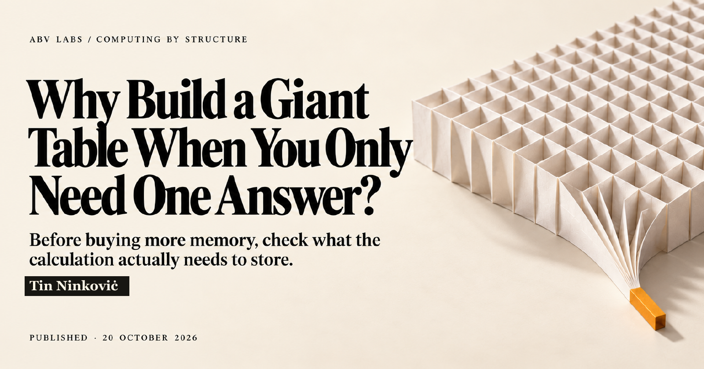

# ABV Labs publications

[Complete offline reader ZIP](https://thereelninoninkovic.github.io/abv-labs-publications/publications/giant-table-one-answer/v0.3.3-cover.1/Giant-table-one-answer-complete-reader-v0.3.3-cover.1.zip) · [Reader bundle release](https://github.com/thereelninoninkovic/abv-labs-publications/releases/tag/giant-table-one-answer-v0.3.3-reader.2) · [ABV Labs web reading hub](https://thereelninoninkovic.github.io/abv-labs-publications/)

Articles, illustrations and selected data from Tin Ninkoviċ’s research and development work at Awesome Bosnian Ventures, LLC.

Start with a question that interests you. Each publication keeps its explanation, figures, PDF and supporting material together so you can read the argument and inspect the evidence behind it.

[Explore the concepts](Explore.md) · [Browse the publication library](#publication-library)

## Publication library

### Why Build a Giant Table When You Only Need One Answer?

Before buying more memory, check what the calculation actually needs to store.

A small worked example explains how a known rule can produce the answers without constructing the full table. The article then walks through historical Python allocation measurements and explains what the numbers mean.

**Tin Ninkoviċ · 20 October 2026 · Cover edition 0.3.3-cover.1**

[Open the publication](docs/publications/giant-table-one-answer/v0.3.3-cover.1/README.md) · [Read the complete article](docs/publications/giant-table-one-answer/v0.3.3-cover.1/Article.md) · [View the PDF](docs/publications/giant-table-one-answer/v0.3.3-cover.1/Article.pdf) · [Get the data and methods](https://github.com/thereelninoninkovic/abv-labs-publications/releases/download/giant-table-one-answer-v0.3.3-reader.1/Giant-table-one-answer-data-and-methods-v0.2.1.zip)

[Download the matching PDF](https://thereelninoninkovic.github.io/abv-labs-publications/publications/giant-table-one-answer/v0.3.3-cover.1/Article.pdf) · [Versioned release and checksums](https://github.com/thereelninoninkovic/abv-labs-publications/releases/tag/giant-table-one-answer-v0.3.3-reader.1)

## What you will find here

The Markdown article is the complete illustrated reading edition. The PDF carries the matching publication edition. Selected data and methods let you inspect the reported comparison; the article explains which source records remain private.

My broader research and development corpus includes implemented working architectures. Each publication explains a selected part of that work and states the limits of its examples and evidence. A conceptual diagram, a historical measurement and a newly executed test answer different questions; the publication tells you which one you are looking at.

## Reuse

Original publication text and artwork are shared under [CC BY-NC-SA 4.0](https://creativecommons.org/licenses/by-nc-sa/4.0/). Give credit, identify changes, keep adaptations under the same terms and obtain separate permission for commercial reuse where required. Third-party material retains its own terms. The license does not grant patent or trademark rights.

Original text and artwork © 2026 Tin Ninkoviċ and Awesome Bosnian Ventures, LLC. Publication-specific assistance and source notes appear with each article.
