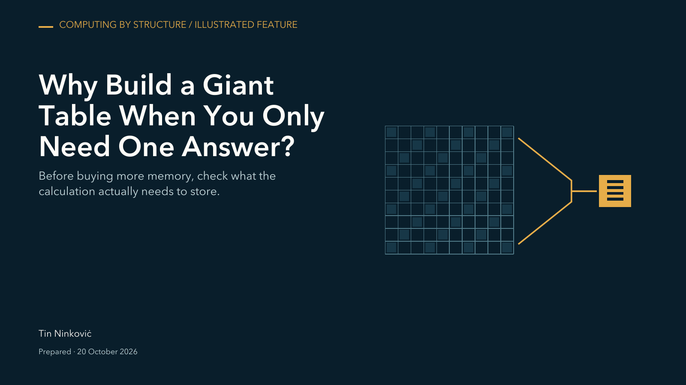

# Why Build a Giant Table When You Only Need One Answer?

**Tin Ninkoviċ · ABV Labs · 20 October 2026 · Edition 0.3.3**

Tin Ninkoviċ is also known as Nino Ninkoviċ. This edition uses Tin for the byline and legal notice; earlier publications retain their original attribution.

Before buying more memory, check what the calculation actually needs to store.

[Read the complete illustrated article](Article.md) · [View the PDF](Article.pdf) · [Sources](Article.md#sources-and-scope)

A calculation can build a large table to produce a short list of answers. This article starts with an everyday materials-planning example, works through a small numerical rule and then explains real allocation measurements retained from an earlier research session.

At the largest tested input size, the direct method recorded about 99.8% less median traced Python allocation than the full-table method, with closely agreeing answers. The article explains the measurement and its limits: this chosen calculation, historical local runs, no whole-application memory or speed claim.

## Choose how to read

| Edition | What it gives you |
| --- | --- |
| [Illustrated article](Article.md) | The complete explanation with six figures, a worked example, the measurement table and source notes. |
| [Matching PDF](Article.pdf) | The eight-page designed edition, with the same argument, figures, values and evidence boundaries. GitHub opens a PDF preview when supported by your viewer. |
| [Standalone HTML](Article.html) | A semantic reading file with mobile figure renditions. GitHub displays its source; download it with the accompanying figures to use it locally. |
| [Concept guide](../../../Explore.md) | Short routes into the ideas, without requiring the technical vocabulary first. |

[Download the matching PDF](https://github.com/thereelninoninkovic/abv-labs-publications/releases/download/giant-table-one-answer-v0.3.3-reader.1/Giant-table-one-answer-v0.3.3.pdf) · [Versioned release and checksums](https://github.com/thereelninoninkovic/abv-labs-publications/releases/tag/giant-table-one-answer-v0.3.3-reader.1)

## Data and methods

[Download the selected data and methods](https://github.com/thereelninoninkovic/abv-labs-publications/releases/download/giant-table-one-answer-v0.3.3-reader.1/Giant-table-one-answer-data-and-methods-v0.2.1.zip).

The download includes the 25 paired historical observations, five-size median summary, calculated comparisons, field definitions and measurement-scope notes. Five pairs means five runs of each method. The figures compare separate method medians; the article explains the distinction beside the table.

These are retained measurements and recalculated summaries, not a new benchmark run. Original implementation code and the private multi-topic research archive are outside this reader download. Private source availability is stated in the article; the public prior-work reference is linked there.

## Where this concept sits

My research and development corpus includes implemented working architectures. This publication explains one established numerical-computing principle through an illustrative structured example and a historical local allocation comparison. Its measurements apply to the chosen example and recorded environment.

[Minimal publication metadata](publication.json) records the title, author, date, edition, license and matching PDF identity. It is a reading and citation aid, separate from private editorial review records.

## Credit and reuse

Original text and artwork © 2026 Tin Ninkoviċ and Awesome Bosnian Ventures, LLC. [CC BY-NC-SA 4.0](https://creativecommons.org/licenses/by-nc-sa/4.0/). Editorial preparation assisted by Codex/OpenAI. Third-party sources retain their own terms.

[← Publication library](../../../README.md) · [Explore the concepts](../../../Explore.md)
