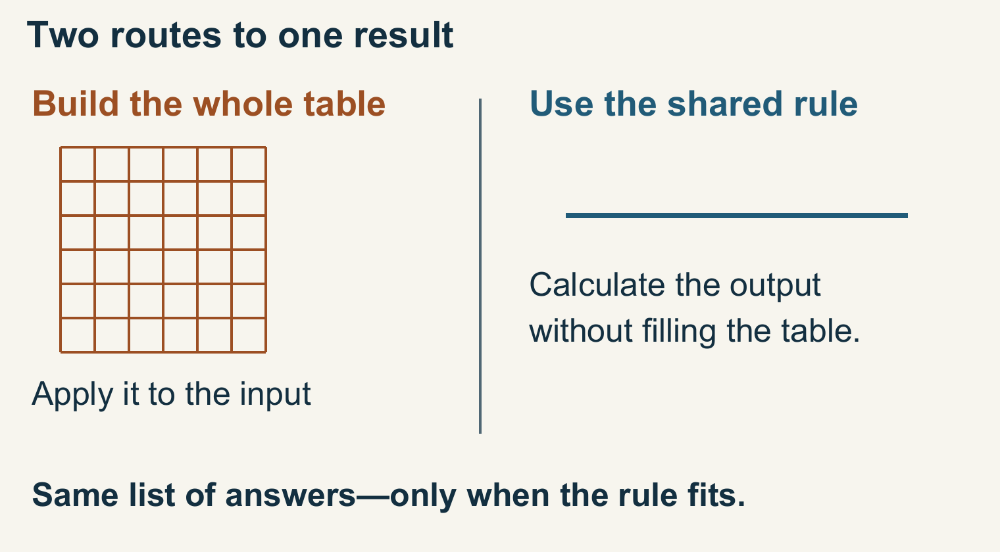
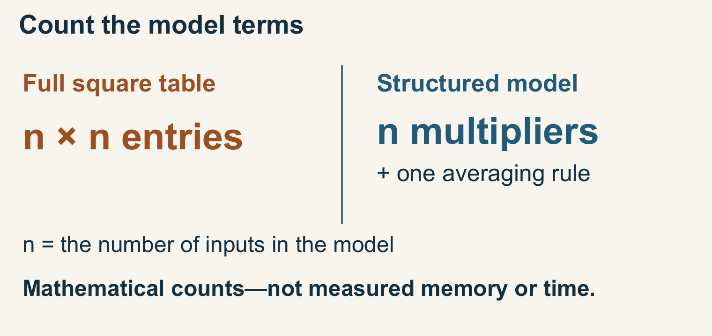
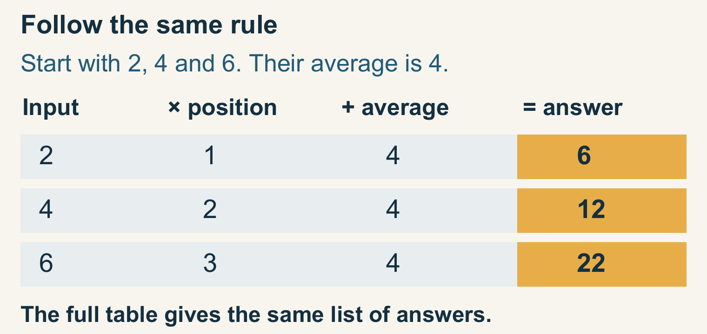
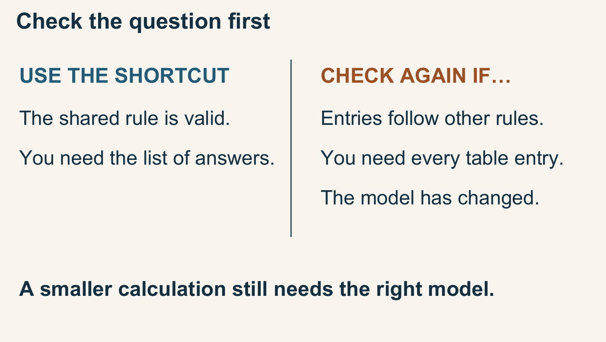
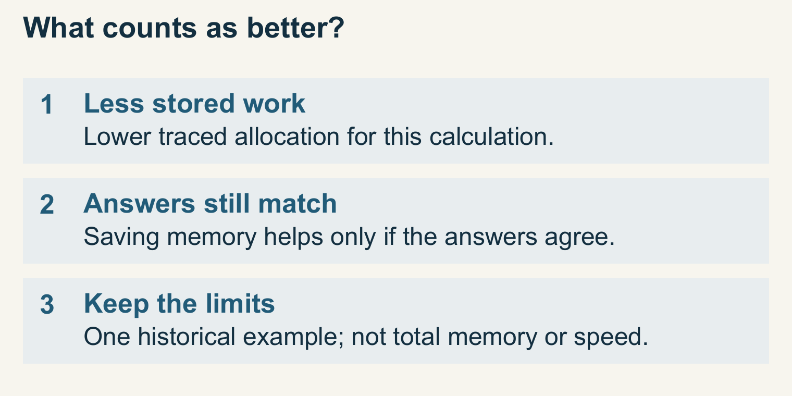
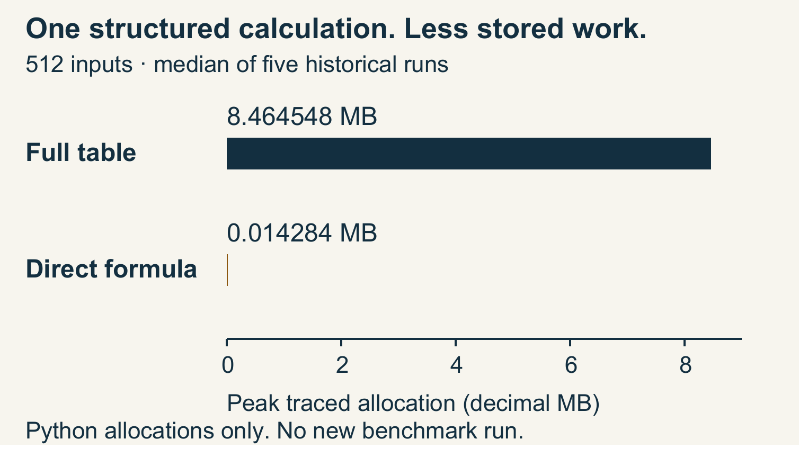

# Why Build a Giant Table When You Only Need One Answer?

Before buying more memory, check what the calculation actually needs to store.

By Tin Ninkoviċ

## Start with the question the calculation needs to answer

Imagine a workshop that makes several products. Each product needs different amounts of wood, paint and packaging.

You want to know how much material a proposed order will use.

One approach is to keep a table: products across one direction, materials across the other.

Multiply each product’s requirements by the quantity ordered, then add the contributions for each material. The result tells you what to buy.

This is a hypothetical example, and an ordinary table may be exactly the right tool for that workshop.

But it raises a useful question for much larger calculations: do we need to store every entry in the table, or can we calculate the required totals another way?

Sometimes we can calculate the result directly. The relationships may follow a simple rule.

Rather than writing down every number first, we can use that rule to calculate the result directly. [3]

Two routes produce the same list of answers: build the full table and apply it, or use the rule directly without filling the table. Original ABV Labs illustration; created with AI assistance.

The distinction becomes important when the table is enormous.

A calculation can run out of memory while preparing an intermediate object that its next step never needs to see in full.

When I look at an expensive calculation, I want to know what the next step actually needs before asking the computer to hold more.

We may need the full object. We may need only its effect on one particular input. Those are different jobs.

## A table can grow much faster than its answer

Mathematicians call a rectangular table of numbers a matrix. A vector is an ordered list of numbers.

In the workshop example, the order quantities form a list. Multiplying the table by that list produces another list: the material totals.

The order matters. If the first position means chairs and the second means tables, swapping them changes the calculation.

A matrix and a vector are useful partly because they make those positions and relationships explicit.

Now consider a square table with one row and one column for each quantity.

With four quantities, it has sixteen entries. With a thousand, it has a million. Doubling the number of quantities makes the table four times as large.

The resulting list still has one entry per row. A thousand-by-thousand table can therefore produce a list of only a thousand answers.

The full table contains n × n entries. This model can instead keep n multipliers and one averaging rule. Here n is the number of inputs. Input and answer lists are excluded from both counts. These are mathematical counts, not measured memory or running time. Original ABV Labs illustration; created with AI assistance.

These are counts of numbers in a representation. They are not measurements of a particular computer’s memory.

Real programs also store instructions, bookkeeping, temporary values and sometimes several copies of an object.

The distinction matters when someone turns a neat diagram into a claim about actual resource use.

Still, the difference in shape tells us where to look.

If we create a million entries only to combine them into a thousand results, it is worth asking whether the million entries have to exist together at all.

That question has established answers in numerical computing.

It does not mean every large table can be replaced by a short rule. It means the representation deserves to be examined alongside the calculation.

## A small rule can sometimes do the same job

Here is a deliberately simple mathematical example. Take a list of numbers.

For the first output, multiply the first input by one. For the second, multiply the second input by two. Continue that pattern.

Then add the average of the whole input list to every output.

Use the list two, four and six. Its average is four.

The first output is two times one, plus four: six.

The second is four times two, plus four: twelve.

The third is six times three, plus four: twenty-two.

For the illustrative list 2, 4, 6, the average is 4. Multiply each input by its position, then add 4: the answers are 6, 12 and 22. The full-table calculation gives the same list. Original ABV Labs illustration; created with AI assistance.

We can describe exactly the same operation with a three-by-three matrix.

Its diagonal holds the multipliers one, two and three, with an extra one-third added. Every other entry is one-third.

Multiplying that matrix by the input list produces the same three answers.

The rule makes the relationship easier to see. Each output needs its own input and the shared average.

We can calculate the average once and reuse it. We do not need to build the entire table of numbers first.

Nothing has been approximated in that algebraic identity. We have changed how the operation is expressed.

On a real computer, the order of arithmetic can produce small rounding differences, so an implementation still needs an appropriate comparison.

The important restriction is that this table has a very particular structure.

A different table may require a different rule, and an arbitrary table may have no equally simple replacement. We cannot infer a universal shortcut from a friendly example.

The example also shows why it helps to write down the actual operation. “Make this faster” is a broad instruction.

“Produce the same output list without first storing this structured table” gives us something specific to reason about and check.

## Where the Hessian comes in

One place this distinction appears is in optimization: adjusting a set of choices to improve a result.

A program might be fitting a mathematical model or reducing an error. Its next move depends on information about how the result changes when the choices change.

Use the direct calculation when the shared rule is valid and the requested result is a list of answers. Different entry rules, a changed model or a need for every table entry require a fresh check. Original ABV Labs illustration; created with AI assistance.

A Hessian is a matrix of second derivatives. In ordinary language, it describes local curvature: how the rate of change itself varies, including interactions between the quantities being adjusted.

Think of the difference between moving across a gentle slope and approaching a steep bend.

The idea is local; a picture of curvature at one point is not a map of the whole landscape.

Some optimization methods need the Hessian multiplied by a particular vector. That calculation is called a Hessian-vector product.

It asks for the matrix’s effect along that input, rather than asking to inspect every matrix entry.

Established methods can compute such products without explicitly storing a full Hessian.

The right method depends on the function, available derivatives, software and required numerical behavior. That field is much broader than the small structured example here.

In our example, the table can be the Hessian of a simple quadratic function, a function made from squared quantities and their combinations.

Its structure is known in advance. That is why the direct formula is so straightforward.

Automatic differentiation is software that follows a calculation’s elementary operations to compute derivatives. This example uses a known formula instead.

Applying the idea to a different scientific model requires its own derivation and checks.

It gives us a clean way to separate two questions: what mathematical action is required, and what object must the program construct to perform it? [5](https://www.bcl.hamilton.ie/~barak/papers/nc-hessian.pdf)

## Check the result, then measure the implementation

A retained experiment from an earlier research session compared a program that built the full table with a program that used the direct structured rule.

It tested five sizes, from 32 to 512 quantities. At each size, the two methods ran on the same input five times each: five paired comparisons, or ten executions. Across all five sizes, there were 25 pairs.

These are historical local measurements inspected for this article, not a new run or an independent replication.

At the largest size, the middle reading from five runs—the median—was about 8.46 megabytes for the table-building method and 0.014 megabytes for the direct method.

Here a megabyte means one million bytes. The chart reports Python allocations traced during the calculation, not the memory used by the whole computer or application. [1]

Both methods produced closely agreeing numerical answers for this chosen example.

That matters: reducing the measured allocation would be of little use if the replacement no longer performed the required calculation.

A different function or real application still needs its own correctness and resource checks.

A lower memory reading is useful only if the answers still agree closely enough for the task. A smaller number with wrong answers would be a failed replacement.

Read the historical comparison in three parts: the direct formula recorded lower traced allocation; its answers still closely agreed; and the measurement covers traced Python allocations for this chosen example, not total machine memory or a general speedup. Original ABV Labs illustration; created with AI assistance.

The recorded environment was Python 3.12.14 on Linux. Input construction happened before tracing began.

The measurement excludes the process baseline and allocations the Python tracer cannot see, including untraced native allocations. [2]

Each pair ran the table-building method first. The record therefore supports this specific allocation comparison; it should not be sold as a general speed or whole-application memory improvement.

There is also a separate small teaching fixture in the archive. It evaluates matrix entries inside sums instead of retaining the full table, and reports representation counts rather than measured memory.

Those counts are useful for explaining the mathematics, but they are not the measurements in this chart.

Keeping the two examples separate avoids giving a numerical claim the wrong evidence. [4]

I would check the answers first and measure resource use separately. A smaller allocation is useful only if the calculation still does its job.

First, define which inputs the calculation must handle and the required output. Include ordinary cases and cases likely to expose mistakes. Decide in advance how numerical differences will be judged.

Then compare implementations that do the intended work. If the question is whether storing a dense matrix is costly, the measured implementation must actually store one.

Record how memory is measured, what that measurement excludes and which temporary objects are included. Time the calculation under clearly described conditions.

Finally, check whether the proposed replacement remains suitable for the real task.

Perhaps another part of the program needs individual entries. Perhaps the structure changes. Perhaps a method uses the matrix more than once in different ways.

Saving work in one step can create work elsewhere.

Before asking for a bigger machine, I would start with four questions:

- What does the next step consume?
- Is the full table needed, or just one operation using it?
- Is there a mathematical structure we can use?
- What checks would establish that the replacement still does the required job?

A larger machine can be the right answer. So can a better algorithm or a different representation.

The useful habit is to examine the question before committing resources to the largest object we know how to build.

## Where this concept sits

My research and development corpus includes implemented working architectures.

This article explains one established numerical-computing principle through a structured mathematical example and a historical local allocation comparison.

The measurements apply to that chosen example and recorded environment; they do not establish a new general method, a production speedup or whole-application memory savings.

The workshop is hypothetical. The arithmetic example is illustrative.

The historical experiment and separate Python teaching fixture were inspected for this article; neither was rerun as part of preparing this edition.

Original text and artwork © 2026 Tin Ninkoviċ and Awesome Bosnian Ventures, LLC. Editorial preparation assisted by Codex/OpenAI. Original publication material is shared under CC BY-NC-SA 4.0.

## Sources and scope

[1] ABV Labs. Structured quadratic experiment, retained in the 13 October 2026 research snapshot. Twenty-five historical paired comparisons across five input sizes. Selected observations and calculated medians accompany this edition; the original archive remains private.

[2] ABV Labs. Exact Bytes, Bounded Work — methods appendix. Defines the structured calculation, traced-allocation metric and exclusions. Relevant methods are explained in this article and its reader dataset; original appendix retained privately.

[3] ABV Labs. The Hessian That Fits in Memory. Earlier editorial background, not independent validation. Its measured statements are reconciled to the separate historical experiment. Retained privately.

[4] ABV Labs. Small structured-quadratic teaching fixture. Separate three-size check of numerical agreement and representation counts. It does not supply the allocation measurements; source retained privately.

[5] [Fast Exact Multiplication by the Hessian](https://www.bcl.hamilton.ie/~barak/papers/nc-hessian.pdf). Barak A. Pearlmutter. Fast Exact Multiplication by the Hessian. Neural Computation 6(1), 147–160 (1994). doi:10.1162/neco.1994.6.1.147.

## What the recorded results mean

Here is what the retained measurements mean. Each row is one input size. Read across to compare two methods doing the same calculation. A lower memory reading is useful only when the answers still agree closely enough.

## How to read the recorded measurements

- Input numbers: length of the input list. Larger inputs require a larger square table.
- Runs per method: five runs of each method; five pairs means ten executions.
- Median: the middle of five readings put in order, calculated separately for each method.
- Bytes: storage units; 1,000,000 bytes make one decimal megabyte.
- Traced peak: the highest Python-tracked allocation during a run, not all application or computer memory.

Input numbers | Runs per method | Full table (bytes) | Direct rule (bytes)
--- | --- | --- | ---
32 | 5 | 32,304 | 408
64 | 5 | 131,888 | 664
128 | 5 | 530,440 | 1,872
256 | 5 | 2,140,360 | 6,064
512 | 5 | 8,464,548 | 14,284

Median traced Python peak allocations in the retained historical experiment. Five paired runs per size; bytes, not resident memory. These summaries were recalculated from saved observations, without rerunning either implementation.

At 512 inputs, the median of five historical runs was 8,464,548 versus 14,284 bytes of traced Python peak allocation. Decimal MB use 1,000,000 bytes. This is not total process memory or a new benchmark run. Original ABV Labs chart; retained experimental data reanalysed with AI assistance.

At 512 input numbers, the full-table median was 8,464,548 bytes; the direct-rule median was 14,284 bytes. That is about 99.83% less traced peak allocation, with closely agreeing answers. For this example, the difference is substantial. It is not a 99.83% reduction in whole-application memory, and it says nothing about speed.

These are retained measurements from 25 historical pairs across five sizes, not synthetic data or a new run. The selected observations and methods accompany the reader edition. Each table value is a median for one method; the percentage compares the two medians. [1] [2]
